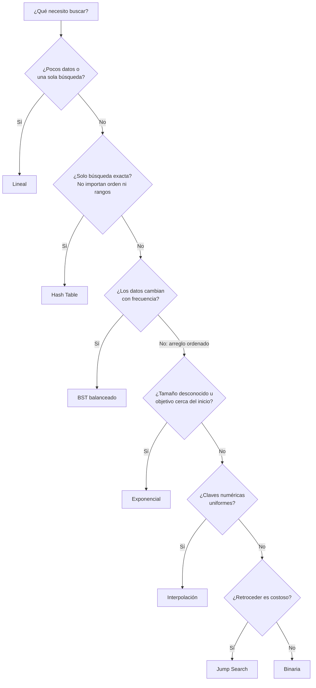

# Algoritmos-de-Busqueda

Para cada algoritmo se presenta su **definición**, su **eficiencia** (tiempo y espacio) y sus **casos de uso**, junto con una traza sobre un mismo arreglo de ejemplo y una implementación en Java 17.

## Tabla de contenido

0. [Conceptos previos](#0-conceptos-previos)
1. [Búsqueda Lineal](#1-búsqueda-lineal)
2. [Búsqueda Binaria](#2-búsqueda-binaria)
3. [Jump Search (búsqueda por saltos)](#3-jump-search-búsqueda-por-saltos)
4. [Interpolation Search (búsqueda por interpolación)](#4-interpolation-search-búsqueda-por-interpolación)
5. [Exponential Search (búsqueda exponencial)](#5-exponential-search-búsqueda-exponencial)
6. [BST Balanceado (árbol binario de búsqueda balanceado)](#6-bst-balanceado-árbol-binario-de-búsqueda-balanceado)
7. [Hash Table (tabla hash)](#7-hash-table-tabla-hash)
8. [Tabla comparativa](#8-tabla-comparativa)
9. [¿Cuál elegir?](#9-cuál-elegir)
10. [Preguntas clave para la sustentación](#10-preguntas-clave-para-la-sustentación)
11. [Referencias](#11-referencias)

---

## 0. Conceptos previos

**Buscar** es determinar si un valor objetivo `x` existe dentro de una colección y, si existe, en qué posición está (o qué dato tiene asociado).

**Notación asintótica:**

| Notación | Significado |
|---|---|
| `O(f(n))` | Cota superior: el algoritmo **no crece más rápido** que `f(n)` |
| `Ω(f(n))` | Cota inferior: el algoritmo **no crece más lento** que `f(n)` |
| `Θ(f(n))` | Cota ajustada: crece **exactamente** al ritmo de `f(n)` |

Se analizan tres escenarios: **mejor caso** (el objetivo se encuentra de inmediato), **caso promedio** (comportamiento esperado) y **peor caso** (el objetivo está en la posición más desfavorable o no existe). La **complejidad espacial** es la memoria adicional que necesita el algoritmo, sin contar los datos de entrada.

Ritmo de crecimiento, de mejor a peor: `O(1) < O(log log n) < O(log n) < O(√n) < O(n)`.

**Arreglo de referencia** (ordenado, `n = 15`), usado en todas las trazas buscando `x = 67`:

| Índice | 0 | 1 | 2 | 3 | 4 | 5 | 6 | 7 | 8 | 9 | 10 | 11 | 12 | 13 | 14 |
|---|---|---|---|---|---|---|---|---|---|---|---|---|---|---|---|
| Valor | 3 | 8 | 12 | 17 | 23 | 31 | 38 | 45 | 52 | 60 | **67** | 74 | 81 | 89 | 96 |

**Sobre las implementaciones:** están escritas en Java 17 en estilo funcional (expresiones, recursión y streams, sin variables mutables) y devuelven `OptionalInt`: el índice si el valor existe o vacío si no existe. Así, "no encontrado" es un valor explícito y no un `-1` mágico ni una excepción. Todas se probaron con aserciones (`java -ea`) para cada elemento del arreglo, valores ausentes, el arreglo vacío y arreglos con valores repetidos.

```java
import java.util.*;
import java.util.stream.*;
```

---

## 1. Búsqueda Lineal

### Definición

También llamada **búsqueda secuencial**. Recorre la colección elemento por elemento, desde el inicio, comparando cada uno con el objetivo hasta encontrarlo o agotar la colección.

- **Precondiciones:** ninguna. No necesita datos ordenados ni acceso aleatorio.

**Pasos:**
1. Empezar en la primera posición.
2. Comparar el elemento actual con `x`.
3. Si son iguales, devolver la posición.
4. Si no, avanzar a la siguiente posición y repetir.
5. Si se llega al final, el elemento no está.

### Traza (`x = 67`)

```
3 → 8 → 12 → 17 → 23 → 31 → 38 → 45 → 52 → 60 → 67 ✓
```
Encontrado en el índice 10 tras **11 comparaciones**.

### Eficiencia

| Caso | Tiempo | Explicación |
|---|---|---|
| Mejor | `O(1)` | El objetivo es el primer elemento |
| Promedio | `O(n)` | ≈ `(n + 1) / 2` comparaciones si existe; `n` si no existe |
| Peor | `O(n)` | El objetivo es el último o no existe |
| **Espacio** | `O(1)` | Solo un índice |

### Casos de uso

- **Colecciones pequeñas** (decenas de elementos): el costo extra de otros métodos no compensa.
- **Datos sin ordenar que se consultan una sola vez:** ordenar cuesta `O(n log n)`, más que una búsqueda lineal `O(n)`.
- **Estructuras sin acceso aleatorio:** listas enlazadas, archivos y flujos secuenciales (por ejemplo, `grep` sobre un log).
- **Búsqueda por condiciones arbitrarias**, no solo igualdad: "el primer estudiante con promedio menor que 3.0".
- **Como paso interno de otros algoritmos:** dentro de un bloque en Jump Search o dentro de una cubeta de una tabla hash.

**Ventajas:** es simple, no tiene precondiciones, funciona sobre cualquier estructura y devuelve la primera ocurrencia.
**Desventajas:** es inviable para colecciones grandes con muchas consultas.

### Implementación

```java
static OptionalInt busquedaLineal(int[] a, int x) {
    return IntStream.range(0, a.length)
            .filter(i -> a[i] == x)
            .findFirst();
}
```

---

## 2. Búsqueda Binaria

### Definición

Algoritmo **divide y vencerás** que, sobre un arreglo **ordenado**, compara el objetivo con el elemento central y descarta la mitad donde el objetivo no puede estar. Repite el proceso sobre la mitad restante hasta encontrarlo o hasta que el rango quede vacío.

- **Precondiciones:** datos **ordenados** y **acceso aleatorio** en `O(1)` (arreglo).

**Pasos:**
1. `lo = 0`, `hi = n − 1`.
2. `mid = lo + (hi − lo) / 2`.
3. Si `a[mid] == x`, se encontró.
4. Si `a[mid] < x`, buscar a la derecha (`lo = mid + 1`); si no, a la izquierda (`hi = mid − 1`).
5. Si `lo > hi`, el elemento no está.

### Traza (`x = 67`)

| Paso | lo | hi | mid | a[mid] | Decisión |
|---|---|---|---|---|---|
| 1 | 0 | 14 | 7 | 45 | 45 < 67 → derecha |
| 2 | 8 | 14 | 11 | 74 | 74 > 67 → izquierda |
| 3 | 8 | 10 | 9 | 60 | 60 < 67 → derecha |
| 4 | 10 | 10 | 10 | 67 | **Encontrado** |

**4 comparaciones** (frente a 11 de la lineal).

### Eficiencia

| Caso | Tiempo | Explicación |
|---|---|---|
| Mejor | `O(1)` | El objetivo está justo en el centro |
| Promedio | `O(log n)` | |
| Peor | `O(log n)` | Máximo `⌊log₂ n⌋ + 1` comparaciones |
| **Espacio** | `O(1)` iterativa / `O(log n)` recursiva | La versión recursiva usa la pila de llamadas |

**¿Por qué `log n`?** Tras `k` comparaciones quedan `n / 2ᵏ` candidatos. El proceso termina cuando queda 1, es decir, cuando `n / 2ᵏ = 1`, o sea `k = log₂ n`. Con un millón de elementos bastan **20 comparaciones** y con mil millones, **30**.

> **Detalle importante:** calcular `mid = (lo + hi) / 2` puede desbordar `int` en arreglos muy grandes. La forma segura es `lo + (hi − lo) / 2`. Este error estuvo cerca de 9 años en `Arrays.binarySearch` de Java (J. Bloch, 2006).

### Casos de uso

- **Buscar en datos ordenados que cambian poco:** diccionarios, catálogos, tablas de códigos. En Java: `Arrays.binarySearch` y `Collections.binarySearch`.
- **Límites inferior y superior** (`lower_bound` / `upper_bound`): la primera posición con valor ≥ `x`, o contar ocurrencias en un rango.
- **Búsqueda sobre la respuesta:** cuando un predicado es monótono (falso…falso, verdadero…verdadero) se busca binariamente el punto de cambio. Ejemplos: la capacidad mínima de un camión para repartir en `d` días, o la raíz cuadrada entera.
- **`git bisect`:** encuentra en `O(log n)` el commit que introdujo un error.
- **Base de los índices de bases de datos:** los B-Trees generalizan esta idea a nodos con muchas claves.

**Ventajas:** es muy rápida y su peor caso está garantizado.
**Desventajas:** exige orden, y mantener el arreglo ordenado al insertar cuesta `O(n)` por inserción. Tampoco sirve en listas enlazadas, porque llegar al medio cuesta `O(n)`.

### Implementación

```java
static OptionalInt busquedaBinaria(int[] a, int x, int lo, int hi) {
    final int mid = lo + (hi - lo) / 2;          // evita el overflow de (lo + hi) / 2
    return lo > hi        ? OptionalInt.empty()
         : a[mid] == x    ? OptionalInt.of(mid)
         : a[mid] < x     ? busquedaBinaria(a, x, mid + 1, hi)
         :                  busquedaBinaria(a, x, lo, mid - 1);
}
// uso: busquedaBinaria(a, 67, 0, a.length - 1)  →  OptionalInt[10]
```

---

## 3. Jump Search (búsqueda por saltos)

### Definición

Algoritmo para arreglos **ordenados** que avanza en **saltos de tamaño fijo `m`** (el óptimo es `m = √n`) hasta encontrar el bloque cuyo último elemento es ≥ `x`. Luego hace una **búsqueda lineal solo dentro de ese bloque**. Es un punto intermedio entre la búsqueda lineal y la binaria.

- **Precondiciones:** datos **ordenados**.

**Pasos:**
1. Calcular el tamaño de salto `m = ⌊√n⌋`.
2. Saltar de bloque en bloque (índices `0, m, 2m, …`) mientras el último elemento del bloque sea menor que `x`.
3. Al encontrar el bloque donde `x` podría estar, recorrerlo linealmente.
4. Si no aparece en ese bloque, no existe.

**¿Por qué `m = √n`?** En el peor caso se hacen `n/m` saltos más `m − 1` comparaciones lineales: `f(m) = n/m + m − 1`. Al derivar e igualar a cero queda `−n/m² + 1 = 0`, de donde `m = √n`. El costo total es ≈ `2√n`.

### Traza (`x = 67`, `m = ⌊√15⌋ = 3`)

| Salto | Bloque (índices) | Último del bloque | ¿≥ 67? |
|---|---|---|---|
| 1 | [0..2] | a[2] = 12 | No |
| 2 | [3..5] | a[5] = 31 | No |
| 3 | [6..8] | a[8] = 52 | No |
| 4 | [9..11] | a[11] = 74 | **Sí** |

Búsqueda lineal en el bloque [9..11]: `a[9] = 60`, `a[10] = 67` ✓. Total: **4 saltos + 2 comparaciones = 6**.

### Eficiencia

| Caso | Tiempo | Explicación |
|---|---|---|
| Mejor | `O(1)` | El objetivo está al inicio del primer bloque |
| Promedio | `O(√n)` | |
| Peor | `O(√n)` | ≈ `2√n` comparaciones |
| **Espacio** | `O(1)` | |

Con un millón de elementos son ≈ 2.000 comparaciones: mucho mejor que la lineal (1.000.000), pero peor que la binaria (20).

### Casos de uso

- **Medios donde retroceder es costoso:** la binaria salta adelante y atrás `O(log n)` veces, mientras que Jump Search solo avanza y **retrocede una única vez**. Esto conviene en cintas, lecturas secuenciales o listas enlazadas ordenadas con punteros de salto.
- **Datos organizados en bloques o páginas:** el patrón "ubicar el bloque y luego buscar dentro" es el de los **índices dispersos** (*sparse index*) de bases de datos y archivos, que localizan primero la página y después el registro.
- **Base conceptual de las *skip lists*:** son listas enlazadas con varios niveles de saltos que generalizan esta idea hasta lograr `O(log n)`. Las usan Redis (*sorted sets*) y `ConcurrentSkipListMap` de Java.

**Ventajas:** es simple, solo avanza y retrocede una vez.
**Desventajas:** es más lenta que la binaria en memoria con acceso aleatorio y requiere orden.

### Implementación

```java
static OptionalInt busquedaSaltos(int[] a, int x) {
    final int paso = Math.max(1, (int) Math.sqrt(a.length));
    return IntStream.iterate(0, i -> i < a.length, i -> i + paso)            // inicio de cada bloque
            .filter(i -> a[Math.min(i + paso, a.length) - 1] >= x)           // primer bloque que puede contener x
            .findFirst()
            .stream()
            .flatMap(i -> IntStream.range(i, Math.min(i + paso, a.length)))  // lineal dentro del bloque
            .filter(i -> a[i] == x)
            .findFirst();
}
```

---

## 4. Interpolation Search (búsqueda por interpolación)

### Definición

Es una mejora de la búsqueda binaria para datos **ordenados y uniformemente distribuidos**. En lugar de probar siempre el centro, **estima la posición probable** del objetivo con una interpolación lineal entre los extremos del rango. Es lo que hace una persona al buscar "Zapata" en un directorio: lo abre cerca del final, no por la mitad.

**Fórmula de sondeo:**

```
pos = lo + (x − a[lo]) · (hi − lo) / (a[hi] − a[lo])
```

- **Precondiciones:** datos **ordenados**, claves **numéricas** y distribución aproximadamente **uniforme**.

**Pasos:**
1. Si `x` está fuera de `[a[lo], a[hi]]`, no existe.
2. Calcular `pos` con la fórmula.
3. Si `a[pos] == x`, se encontró. Si `a[pos] < x`, continuar en `[pos + 1, hi]`; si no, en `[lo, pos − 1]`.

### Traza (`x = 67`)

| Sondeo | lo | hi | Cálculo | pos | a[pos] | Decisión |
|---|---|---|---|---|---|---|
| 1 | 0 | 14 | 0 + (67−3)·14 / (96−3) = 896/93 ≈ 9.6 | 9 | 60 | 60 < 67 → derecha |
| 2 | 10 | 14 | 10 + (67−67)·4 / (96−67) = 10 | 10 | 67 | **Encontrado** |

**2 sondeos** (frente a 4 de la binaria), porque los datos del ejemplo son casi uniformes.

### Eficiencia

| Caso | Tiempo | Explicación |
|---|---|---|
| Mejor | `O(1)` | La primera estimación acierta |
| Promedio | `O(log log n)` | Con distribución uniforme (Perl, Itai y Avni, 1978) |
| Peor | `O(n)` | Con distribución sesgada, avanza de a una posición |
| **Espacio** | `O(1)` iterativa / `O(log log n)` recursiva en promedio | |

Con mil millones de claves uniformes: `log₂(log₂ 10⁹) ≈ log₂ 30 ≈ 5` sondeos.

**Ejemplo del peor caso:** `a = [1, 2, 3, …, 99, 1 000 000]`. Al buscar 99, la fórmula da `pos ≈ 0`, luego `≈ 1`, luego `≈ 2`… El valor atípico al final arruina la estimación y el algoritmo se vuelve lineal.

### Casos de uso

- **Claves numéricas densas o secuenciales:** IDs autoincrementales, números de factura y códigos de producto consecutivos.
- **Series de tiempo con muestreo regular:** lecturas de sensores cada segundo o logs con marcas de tiempo uniformes.
- **Grandes volúmenes en memoria o disco**, donde cada sondeo es caro y reducir sondeos de `log n` a `log log n` se nota.
- **Directorios telefónicos y diccionarios** (la intuición humana).

**Ventajas:** es la más rápida en promedio entre las búsquedas sobre arreglos ordenados cuando los datos son uniformes.
**Desventajas:** su peor caso es `O(n)`. Cada sondeo es más caro (multiplicación y división). Hay riesgo de **división por cero** (`a[hi] == a[lo]`) y de **desbordamiento** en el producto. Solo sirve para claves que se puedan interpolar numéricamente.

### Implementación

```java
static OptionalInt busquedaInterpolacion(int[] a, int x, int lo, int hi) {
    return lo > hi || x < a[lo] || x > a[hi] ? OptionalInt.empty()
         : a[lo] == a[hi]                     ? OptionalInt.of(lo)        // rango constante: evita dividir por 0
         : sondear(a, x, lo, hi, lo + (int) (((long) x - a[lo]) * (hi - lo) / ((long) a[hi] - a[lo])));
}

static OptionalInt sondear(int[] a, int x, int lo, int hi, int pos) {
    return a[pos] == x ? OptionalInt.of(pos)
         : a[pos] < x  ? busquedaInterpolacion(a, x, pos + 1, hi)
         :               busquedaInterpolacion(a, x, lo, pos - 1);
}
```

---

## 5. Exponential Search (búsqueda exponencial)

### Definición

También llamada **búsqueda galopante** (*galloping*) o **doblada**. Trabaja sobre datos **ordenados** en dos fases:

1. **Encontrar el rango:** duplica un límite (`1, 2, 4, 8, 16, …`) hasta que `a[límite] ≥ x` o el límite se salga del arreglo.
2. **Búsqueda binaria** dentro de `[límite/2, min(límite, n − 1)]`.

Su costo depende de la **posición `i` del objetivo**, no del tamaño total. Por eso funciona incluso cuando **no se conoce el tamaño** de la colección.

- **Precondiciones:** datos **ordenados** con acceso por índice.

### Traza (`x = 67`)

| Fase | Límite | a[límite] | Decisión |
|---|---|---|---|
| 1 | 1 | 8 | 8 < 67 → duplicar |
| 1 | 2 | 12 | 12 < 67 → duplicar |
| 1 | 4 | 23 | 23 < 67 → duplicar |
| 1 | 8 | 52 | 52 < 67 → duplicar |
| 1 | 16 | — | Se sale del arreglo → rango [8, 14] |
| 2 | — | — | Binaria en [8, 14]: mid 11 (74) → mid 9 (60) → mid 10 (67) ✓ |

**4 + 3 = 7 comparaciones.** En un arreglo pequeño no supera a la binaria. Su ventaja aparece cuando `n` es enorme y el objetivo está cerca del inicio: con `n = 10⁹` y el objetivo en la posición 10, la exponencial usa ≈ 9 comparaciones (5 duplicaciones + 4 de binaria) y la binaria ≈ 30.

### Eficiencia

| Caso | Tiempo | Explicación |
|---|---|---|
| Mejor | `O(1)` | El objetivo está en las primeras posiciones |
| Promedio | `O(log i)` | `i` = posición del objetivo |
| Peor | `O(log n)` | El objetivo está al final (≈ `2·log₂ n` comparaciones) |
| **Espacio** | `O(1)` iterativa / `O(log i)` recursiva | |

La fase 1 hace `⌈log₂ i⌉` duplicaciones y la fase 2 hace una binaria sobre un rango de tamaño ≤ `i`. Las dos son `O(log i)`.

### Casos de uso

- **Colecciones no acotadas o de tamaño desconocido:** flujos ordenados, archivos que crecen, APIs paginadas o un "arreglo infinito" (Bentley y Yao, 1976).
- **Cuando el objetivo probablemente está cerca del inicio:** eventos recientes o valores pequeños.
- **TimSort** (el `Arrays.sort` de objetos en Java y el `sort` de Python) usa el **modo galopante** para fusionar *runs* rápidamente.
- **Intersección de listas ordenadas** en motores de búsqueda (listas de documentos por palabra): se "galopa" en la lista larga para buscar cada elemento de la corta.

**Ventajas:** se adapta a la posición del objetivo y no necesita conocer `n`.
**Desventajas:** si el objetivo está al final, hace ≈ el doble de comparaciones que la binaria.

### Implementación

```java
static OptionalInt busquedaExponencial(int[] a, int x) {
    final int limite = IntStream.iterate(1, b -> b * 2)                      // 1, 2, 4, 8, 16, ...
            .filter(b -> b >= a.length || a[b] >= x)
            .findFirst()
            .getAsInt();
    return busquedaBinaria(a, x, limite / 2, Math.min(limite, a.length - 1));
}
```

---

## 6. BST Balanceado (árbol binario de búsqueda balanceado)

### Definición

Un **árbol binario de búsqueda (BST)** es una estructura donde cada nodo tiene una clave y se cumple la **invariante de orden**: todas las claves del subárbol izquierdo son menores y todas las del derecho son mayores. Para buscar se compara con la raíz y se baja a la izquierda o a la derecha, de modo que cada paso descarta un subárbol completo.

Un BST es **balanceado** cuando mantiene su **altura en `O(log n)`** sin importar el orden de inserción. Para lograrlo aplica **rotaciones** después de cada inserción o eliminación. Las variantes principales son:

| Variante | Regla de balance | Altura máxima |
|---|---|---|
| **AVL** (Adelson-Velsky y Landis, 1962) | En cada nodo, las alturas de los subárboles izquierdo y derecho difieren a lo sumo en 1 | ≈ `1.44 · log₂ n` |
| **Rojo-Negro** | Nodos coloreados; mismo número de nodos negros en todo camino raíz-hoja; un rojo no tiene hijos rojos | `≤ 2 · log₂(n + 1)` |
| **B-Tree / B+Tree** | Nodos con muchas claves; todas las hojas al mismo nivel | `O(log_m n)`, pensado para disco |

**¿Por qué importa el balance?** Si se insertan las claves ya ordenadas (3, 8, 12, 17, …) en un BST sin balancear, cada nodo queda como hijo derecho del anterior y el árbol **degenera en una lista enlazada** de altura `n`. La búsqueda pasa a ser `O(n)`.

**Ejemplo de rotación (AVL)** al insertar 10, 20 y 30 en ese orden:

```
10                         20
  \                       /  \
   20      rotación      10    30
     \     izquierda
      30   ─────────►
(desbalanceado, altura 3)  (balanceado, altura 2)
```

### Traza (`x = 67`)

BST balanceado construido con el arreglo de referencia:

```
                     45
             ┌───────┴───────┐
            17               74
         ┌───┴───┐       ┌───┴───┐
         8       31      60      89
       ┌─┴─┐   ┌─┴─┐   ┌─┴─┐   ┌─┴─┐
       3   12  23  38  52  67  81  96
```

| Paso | Nodo | Decisión |
|---|---|---|
| 1 | 45 | 67 > 45 → derecha |
| 2 | 74 | 67 < 74 → izquierda |
| 3 | 60 | 67 > 60 → derecha |
| 4 | 67 | **Encontrado** |

**4 comparaciones = altura del árbol.** Un BST balanceado es, en esencia, una búsqueda binaria "materializada" en una estructura que además admite inserciones y eliminaciones eficientes.

### Eficiencia

| Operación | Tiempo | Explicación |
|---|---|---|
| Búsqueda (mejor caso) | `O(1)` | El objetivo es la raíz |
| Búsqueda (promedio y peor caso) | `O(log n)` | **Garantizado** por el balance |
| Inserción / eliminación | `O(log n)` | Incluye las rotaciones (`O(1)` cada una) |
| Mínimo, máximo, sucesor, predecesor | `O(log n)` | |
| Recorrido en orden | `O(n)` | Entrega las claves ordenadas |
| **Espacio** | `O(n)` | Un nodo con dos referencias por clave; la búsqueda recursiva usa `O(log n)` de pila |

**AVL vs. Rojo-Negro:** el AVL está balanceado de forma más estricta, así que sus búsquedas son algo más rápidas. El Rojo-Negro hace menos rotaciones al insertar y eliminar, por eso lo prefieren las librerías estándar.

### Casos de uso

- **Diccionarios y conjuntos ordenados:** `TreeMap` y `TreeSet` de Java (Rojo-Negro), `std::map` y `std::set` de C++.
- **Consultas por rango y vecino más cercano:** `floor`, `ceiling` y `subMap`. Por ejemplo, "todas las reservas entre las 8:00 y las 10:00" o "el precio más cercano por debajo de X".
- **Datos dinámicos** con inserciones y eliminaciones frecuentes mezcladas con búsquedas. En un arreglo ordenado cada inserción cuesta `O(n)`.
- **Sistemas operativos:** el planificador de procesos de Linux (CFS/EEVDF) ordena las tareas en un árbol Rojo-Negro.
- **Bases de datos y sistemas de archivos:** los índices de MySQL (InnoDB), PostgreSQL, NTFS y Btrfs usan B-Trees/B+Trees.
- **Libros de órdenes** (bolsas de valores) y **rankings**, donde importan el orden y las actualizaciones constantes.

**Ventajas:** su peor caso está garantizado, mantiene el orden y admite rangos y operaciones dinámicas en `O(log n)`.
**Desventajas:** es más complejo de implementar, usa más memoria (punteros) y su localidad de caché es peor que la de un arreglo. En promedio es más lento que una tabla hash para búsquedas exactas.

### Implementación

```java
record Nodo(int clave, Nodo izq, Nodo der) {}

// Árbol perfectamente balanceado a partir de un arreglo ordenado (la raíz es el elemento central)
static Nodo construirBalanceado(int[] a, int lo, int hi) {
    final int mid = lo + (hi - lo) / 2;
    return lo > hi ? null
         : new Nodo(a[mid], construirBalanceado(a, lo, mid - 1), construirBalanceado(a, mid + 1, hi));
}

static boolean buscarEnArbol(Nodo n, int x) {
    return n != null
        && (x == n.clave() || buscarEnArbol(x < n.clave() ? n.izq() : n.der(), x));
}
```

En la práctica se usa `TreeMap`, que mantiene el balance con rotaciones Rojo-Negro en cada inserción:

```java
TreeMap<Integer, String> horario = new TreeMap<>(Map.of(8, "Cálculo", 10, "Lógica", 14, "Lenguajes"));
horario.floorKey(11);                // 10 → la clase que ya empezó
horario.ceilingKey(11);              // 14 → la próxima clase
horario.subMap(8, true, 12, true);   // {8=Cálculo, 10=Lógica}
```

---

## 7. Hash Table (tabla hash)

### Definición

Una **tabla hash** asocia claves con valores usando una **función hash** `h(k)` que transforma la clave en un índice de un arreglo de `m` **cubetas** (*buckets*):

```
índice = h(k) mod m
```

En lugar de comparar con otros elementos, **calcula directamente dónde debería estar** la clave. Solo compara cuando varias claves caen en la misma cubeta (**colisión**).

**Componentes:**

| Componente | Descripción |
|---|---|
| **Función hash** | Debe ser determinista, rápida y repartir las claves de forma uniforme |
| **Manejo de colisiones** | **Encadenamiento:** cada cubeta guarda una lista. **Direccionamiento abierto:** se busca otra celda libre mediante sondeo lineal, sondeo cuadrático o doble hash |
| **Factor de carga** `α = n / m` | Qué tan llena está la tabla. A mayor `α`, más colisiones |
| **Rehashing** | Cuando `α` supera un umbral, se duplica `m` y se reinsertan todas las claves (`O(n)` ocasional, `O(1)` amortizado) |

En **Java `HashMap`**: la capacidad inicial es 16, el factor de carga es 0.75 y el índice se calcula como `(m − 1) & (h ^ (h >>> 16))`, con `m` potencia de 2. Desde Java 8, una cubeta con más de 8 elementos se convierte en un **árbol Rojo-Negro** (siempre que la tabla tenga al menos 64 cubetas), lo que acota el peor caso de esa cubeta a `O(log n)`.

### Traza (`m = 13`, `h(k) = k mod 13`, encadenamiento)

| Cubeta | 0 | 1 | 2 | 3 | 4 | 5 | 6 | 7 | 8 | 9 | 10 | 11 | 12 |
|---|---|---|---|---|---|---|---|---|---|---|---|---|---|
| Claves | 52 | — | **67** | 3, 81 | 17 | 31, 96 | 45 | — | 8, 60 | 74 | 23 | 89 | 12, 38 |

- Buscar **67**: `67 mod 13 = 2` → cubeta 2 → `[67]` ✓ con **1 comparación**.
- Buscar **96**: `96 mod 13 = 5` → cubeta 5 → `[31, 96]` ✓ con 2 comparaciones (colisión).
- Buscar **50**: `50 mod 13 = 11` → cubeta 11 → `[89]` ✗ con 1 comparación: no existe.

En este ejemplo, `α = 15/13 ≈ 1.15`. Con un `m` mayor habría menos colisiones.

### Eficiencia

| Operación | Promedio | Peor caso | Explicación |
|---|---|---|---|
| Búsqueda | `O(1)` | `O(n)` | El peor caso ocurre si todas las claves caen en la misma cubeta |
| Inserción | `O(1)` amortizado | `O(n)` | Incluye el rehashing ocasional |
| Eliminación | `O(1)` | `O(n)` | |
| **Espacio** | `O(n)` | | Más las cubetas vacías |

Con encadenamiento, el costo esperado de una búsqueda es `Θ(1 + α)`. Si `α` se mantiene acotado (≤ 0.75 en Java), el costo es constante.

### Casos de uso

- **Diccionarios clave → valor:** `HashMap` en Java, `dict` en Python, objetos y `Map` en JavaScript.
- **Conjuntos y eliminación de duplicados** (`HashSet`): "¿ya procesé este correo?".
- **Conteo de frecuencias:** palabras de un texto o visitas por usuario.
- **Cachés y memoización:** Redis, Memcached y caché LRU (tabla hash + lista doblemente enlazada).
- **Tablas de símbolos en compiladores:** variable → tipo y dirección.
- **Bases de datos:** índices hash para igualdad exacta y *hash join*.
- **Verificación de pertenencia instantánea en algoritmos:** *two-sum*, detección de ciclos y grafos visitados.

**Ventajas:** es la búsqueda exacta más rápida en promedio y no requiere orden.
**Desventajas:** **no mantiene orden**, así que no permite rangos, mínimo/máximo ni recorrido ordenado. Depende de la calidad de la función hash. Consume memoria extra. Es vulnerable a ataques de **hash flooding** (claves fabricadas para colisionar), que se mitigan con hashes aleatorizados y con la conversión a árbol de Java 8. En Java exige respetar el contrato `equals`/`hashCode`.

### Implementación

Tabla con encadenamiento, solo con fines ilustrativos (su construcción es `O(n·m)`):

```java
static List<List<Integer>> construirTabla(int[] a, int m) {
    return IntStream.range(0, m)
            .mapToObj(cubeta -> Arrays.stream(a).filter(k -> Math.floorMod(k, m) == cubeta).boxed().toList())
            .toList();
}

static boolean buscarEnTabla(List<List<Integer>> tabla, int x) {
    return tabla.get(Math.floorMod(x, tabla.size())).contains(x);   // calcula la cubeta y busca solo ahí
}
// construirTabla(a, 13) → [[52], [], [67], [3, 81], [17], [31, 96], [45], [], [8, 60], [74], [23], [89], [12, 38]]
```

En la práctica se usa `HashMap` o `HashSet`:

```java
Map<String, Integer> frecuencias = Stream.of("pila", "cola", "pila", "arbol", "pila")
        .collect(Collectors.toMap(p -> p, p -> 1, Integer::sum));   // {pila=3, cola=1, arbol=1}
frecuencias.get("pila");             // 3     → O(1) promedio
frecuencias.containsKey("grafo");    // false
```

---

## 8. Tabla comparativa

### Complejidad de la búsqueda

| Algoritmo | ¿Requiere orden? | Estructura | Mejor | Promedio | Peor | Espacio extra | Idea clave |
|---|---|---|---|---|---|---|---|
| **Lineal** | No | Cualquiera | `O(1)` | `O(n)` | `O(n)` | `O(1)` | Revisar uno por uno |
| **Binaria** | Sí | Arreglo | `O(1)` | `O(log n)` | `O(log n)` | `O(1)` | Descartar la mitad |
| **Jump Search** | Sí | Arreglo | `O(1)` | `O(√n)` | `O(√n)` | `O(1)` | Saltar bloques de `√n` y luego lineal |
| **Interpolación** | Sí + uniforme | Arreglo numérico | `O(1)` | `O(log log n)` | `O(n)` | `O(1)` | Estimar la posición |
| **Exponencial** | Sí | Arreglo (aun sin conocer `n`) | `O(1)` | `O(log i)` | `O(log n)` | `O(1)` | Duplicar el rango y luego binaria |
| **BST balanceado** | La estructura lo mantiene | Árbol | `O(1)` | `O(log n)` | `O(log n)` | `O(n)` | Orden en el árbol y altura acotada |
| **Hash Table** | No | Arreglo de cubetas | `O(1)` | `O(1)` | `O(n)`\* | `O(n)` | Calcular la posición |

\* `O(log n)` en Java 8+ gracias a la conversión de cubetas a árbol Rojo-Negro.

### Costo de mantener los datos (insertar un elemento)

| Estructura | Insertar | ¿Permite rangos u orden? |
|---|---|---|
| Arreglo sin ordenar (lineal) | `O(1)` amortizado | No |
| Arreglo ordenado (binaria, saltos, interpolación, exponencial) | `O(n)` (desplazar elementos) | Sí |
| BST balanceado | `O(log n)` | Sí |
| Hash Table | `O(1)` amortizado | No |

### Comparaciones aproximadas en el peor caso

| `n` | Lineal | Binaria | Jump | Interpolación\* | Exponencial\*\* | BST balanceado | Hash\* |
|---|---|---|---|---|---|---|---|
| 1.000 | 1.000 | 10 | ≈ 63 | ≈ 3 | ≈ 20 | ≈ 10 | ≈ 1 |
| 1.000.000 | 1.000.000 | 20 | ≈ 2.000 | ≈ 4 | ≈ 40 | ≈ 20 | ≈ 1 |
| 1.000.000.000 | 1.000.000.000 | 30 | ≈ 63.000 | ≈ 5 | ≈ 60 | ≈ 30 | ≈ 1 |

\* Caso promedio con distribución uniforme o buena función hash. \*\* Objetivo al final del arreglo; si está cerca del inicio, ≈ `2·log₂ i`.

---

## 9. ¿Cuál elegir?



| Situación | Elección | Por qué |
|---|---|---|
| Lista de 20 elementos sin ordenar | Lineal | Ordenar o construir estructuras cuesta más que buscar |
| Catálogo ordenado que casi no cambia | Binaria | `O(log n)` garantizado sin memoria extra |
| Verificar si un usuario ya existe | Hash Table | `O(1)` promedio para igualdad exacta |
| Reservas por rango de horas que cambian todo el día | BST balanceado | Orden, rangos e inserciones en `O(log n)` |
| Registros con IDs consecutivos (1…10⁹) | Interpolación | Distribución uniforme: `O(log log n)` |
| Log ordenado que crece sin conocer su tamaño | Exponencial | No necesita `n` |
| Archivo en cinta o lista con punteros de salto | Jump Search | Solo retrocede una vez |

---

## 10. Preguntas clave para la sustentación

**1. ¿Por qué la búsqueda binaria es `O(log n)`?**
Cada comparación descarta la mitad de los candidatos. Tras `k` pasos quedan `n/2ᵏ`, y el proceso termina cuando `n/2ᵏ = 1`, es decir, `k = log₂ n`.

**2. ¿Por qué el salto óptimo de Jump Search es `√n`?**
El costo es `n/m` saltos más `m` comparaciones lineales. La suma `n/m + m` es mínima cuando `m = √n`, y entonces el total es `2√n`.

**3. ¿Cuándo la interpolación se vuelve `O(n)`?**
Cuando los datos no son uniformes (crecimiento exponencial o valores atípicos). La estimación cae siempre cerca de un extremo y el rango se reduce de a un elemento.

**4. Si ya existe la binaria, ¿para qué sirve la exponencial?**
Sirve cuando no se conoce `n` (colecciones no acotadas) o cuando el objetivo suele estar cerca del inicio. Su costo es `O(log i)` en lugar de `O(log n)`.

**5. ¿Qué pasa con un BST que no está balanceado?**
Puede degenerar en una lista (por ejemplo, al insertar datos ya ordenados) y la búsqueda pasa a `O(n)`. Los AVL y Rojo-Negro lo evitan con rotaciones y garantizan una altura `O(log n)`.

**6. Si la tabla hash es `O(1)`, ¿por qué existen los árboles?**
Porque la tabla hash no mantiene orden: no responde rangos, mínimo/máximo ni "el siguiente mayor". Además, su `O(1)` es promedio, mientras que el árbol garantiza `O(log n)` en el peor caso.

**7. ¿Conviene ordenar para luego usar búsqueda binaria?**
Depende de cuántas búsquedas `k` se harán. `k` búsquedas lineales cuestan `k·n`; ordenar y buscar cuesta `n log n + k log n`. Ordenar conviene cuando `k` es mayor que ≈ `log n`.

**8. ¿Qué es el factor de carga y por qué importa?**
Es `α = n/m` (elementos entre cubetas). El costo esperado de búsqueda es `Θ(1 + α)`. Si `α` crece, hay más colisiones, por eso se hace rehashing al superar un umbral (0.75 en Java).

**9. ¿Por qué `lo + (hi − lo)/2` y no `(lo + hi)/2`?**
Porque `lo + hi` puede superar el máximo de `int` (2³¹ − 1) en arreglos grandes y producir un índice negativo.

---

## 11. Referencias

1. Cormen, T., Leiserson, C., Rivest, R. y Stein, C. (2022). *Introduction to Algorithms* (4.ª ed.). MIT Press. Caps. 2, 11, 12 y 13.
2. Knuth, D. (1998). *The Art of Computer Programming, Vol. 3: Sorting and Searching* (2.ª ed.). Addison-Wesley.
3. Sedgewick, R. y Wayne, K. (2011). *Algorithms* (4.ª ed.). Addison-Wesley. Cap. 3: *Searching*.
4. Shneiderman, B. (1978). Jump searching: a fast sequential search technique. *Communications of the ACM*, 21(10).
